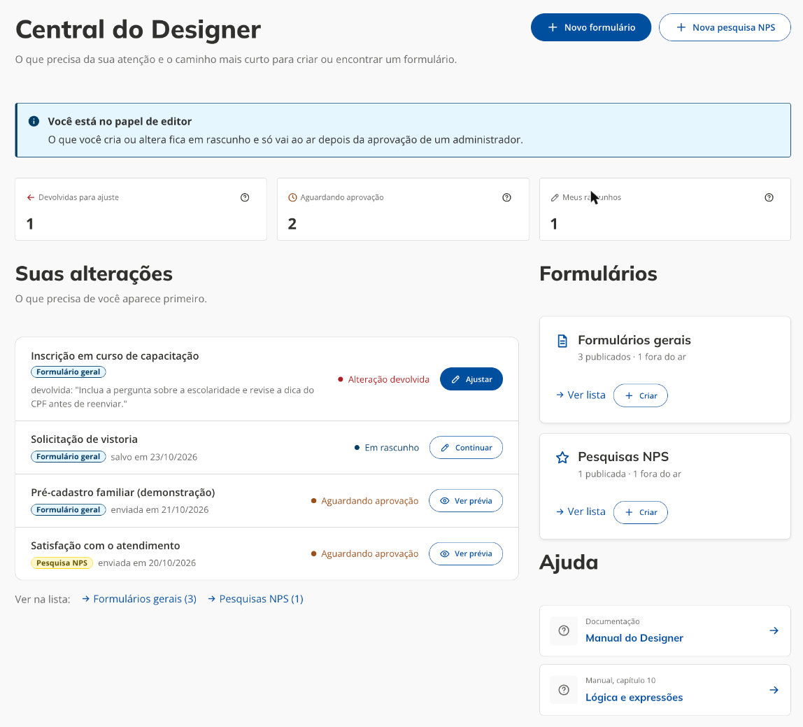

# Acesso e Central do Designer

[← Manual do X-Forms](README.md)

## Entrar no Designer

Abra `/app/x-forms/designer` no endereço do portal. Sem sessão, o portal leva ao login do Smartpass Login e volta para o Designer depois. Com sessão, mas sem um dos grupos do Designer, a tela mostra **Acesso restrito**, com o botão **Voltar ao portal**: peça ao administrador do X-Forms para ser incluído no grupo certo (ver [papéis](README.md#quem-faz-o-quê-papéis)) e entre de novo.

## A tela do Designer

O Designer tem o visual de sistema administrativo do Design System, diferente das páginas do portal:

- **Faixa da marca**, no topo, com o logotipo do portal e os links de Ouvidoria e Transparência.
- **Menu lateral**, à esquerda, com **Central**, **Formulários gerais** e **Pesquisas NPS**. A seção em que você está fica marcada, também na criação, na edição e na revisão. No pé do menu ficam o seu nome e **Sair**. O botão de três linhas recolhe o menu para um trilho de ícones.
- **Trilha**, no topo de cada página (por exemplo "Designer › Formulários gerais › Editar"), para voltar aos níveis acima.
- **Rodapé** compacto do sistema.

## A Central do Designer

A primeira tela é a **Central do Designer**. Ela mostra o que precisa da sua atenção e o caminho mais curto para criar ou encontrar um formulário:

- **Novo formulário** e **Nova pesquisa NPS**, no topo, abrem a criação.
- **Contadores** com o que está em andamento. O contador fica em destaque (laranja ou vermelho) só quando há algo nele; zerado, fica neutro. O ícone ? no canto de cada um explica o que ele conta, ao passar o mouse ou focar pelo teclado.
- **A lista do que pede ação**, com até cinco itens, cada um com a etiqueta do tipo (_Formulário geral_ em azul, _Pesquisa NPS_ em amarelo), a situação e o botão do próximo passo. Abaixo dela, **Ver na lista** abre a listagem de cada tipo já filtrada.
- **Um card por tipo** (formulários gerais e pesquisas NPS), com quantos estão publicados e fora do ar, o link **Ver lista** e o botão **Criar**.
- **Ajuda**, com os links para este manual e para o capítulo [Lógica e expressões](10-logica-e-expressoes.md), no GitLab do repositório. Como saem do portal, o Designer pergunta antes de abrir em uma nova guia.

O que muda é o conteúdo de cada papel:

| Papel         | Contadores                                                                  | Lista                                                                                                                                                                                        |
| ------------- | --------------------------------------------------------------------------- | -------------------------------------------------------------------------------------------------------------------------------------------------------------------------------------------- |
| Administrador | Aguardando sua aprovação, alterações em rascunho e devolvidas aos editores. | **Para revisar**: as alterações enviadas pelos editores, as mais antigas primeiro, com o autor e a data de envio. O botão **Revisar** abre a revisão.                                        |
| Editor        | Devolvidas para ajuste, aguardando aprovação e meus rascunhos.              | **Suas alterações**: as devolvidas primeiro (com o começo da nota do administrador e o botão **Ajustar**), depois os rascunhos (**Continuar**) e as que aguardam aprovação (**Ver prévia**). |

O editor vê também o aviso de que trabalha em rascunho e que nada vai ao ar sem a aprovação de um administrador.

Se a Central não conseguir carregar as pendências, ela avisa e os cards de cada tipo continuam levando às listas.
