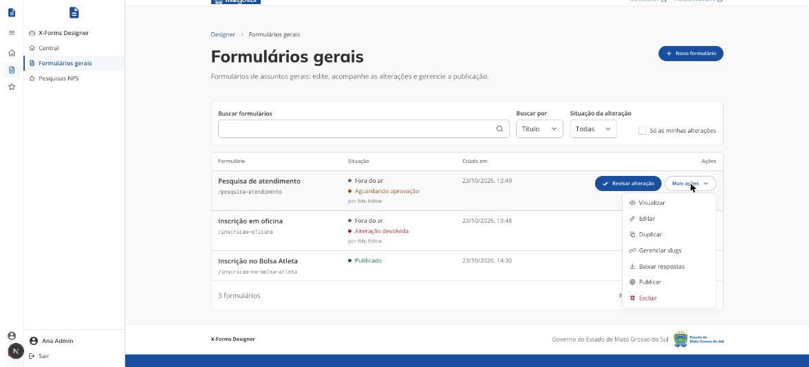
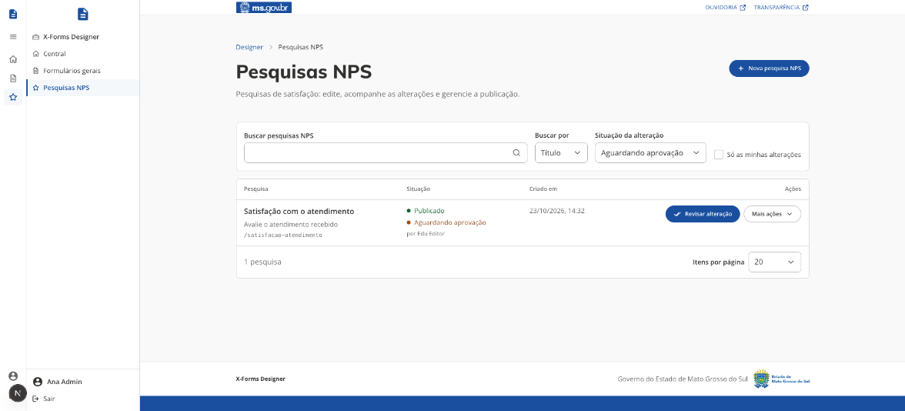
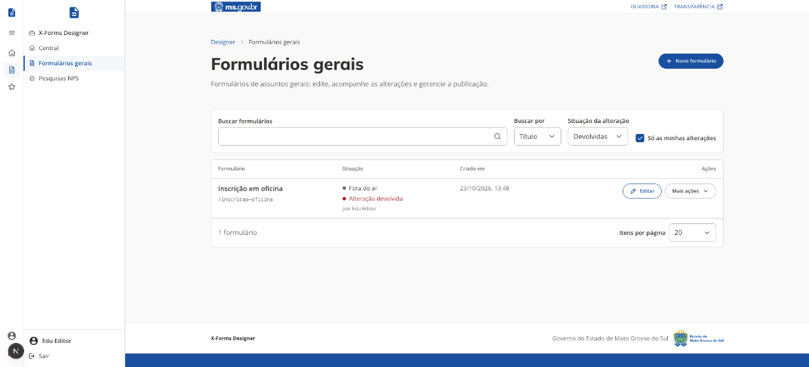

# Lista de formulários

[← Manual do X-Forms](README.md)

A lista de **Formulários gerais** e a de **Pesquisas NPS** funcionam do mesmo jeito: mesmas colunas, filtros e ações. O que muda no NPS está em [Pesquisas NPS](07-pesquisas-nps.md). O botão **Novo formulário** (ou **Nova pesquisa NPS**), no topo, abre a criação.

## As colunas

| Coluna     | O que mostra                                                                                                                                                                                                  |
| ---------- | ------------------------------------------------------------------------------------------------------------------------------------------------------------------------------------------------------------- |
| Formulário | O título, a descrição (quando houver) e o slug principal. "+N slugs" indica slugs secundários.                                                                                                                |
| Situação   | A situação no ar (_Publicado_ ou _Fora do ar_) e, se houver uma alteração em andamento, a situação dela (_Alteração em rascunho_, _Aguardando aprovação_ ou _Alteração devolvida_) com o nome de quem propôs. |
| Criado em  | Data e hora de criação.                                                                                                                                                                                       |
| Ações      | Uma ação principal e o menu **Mais ações** (tabela abaixo).                                                                                                                                                   |

Para o administrador, os formulários com alteração aguardando aprovação aparecem primeiro. No rodapé da lista ficam o total, os itens por página e a paginação.

## Busca e filtros

- **Buscar formulários** e **Buscar por**: procura o texto no título, na descrição ou no slug.
- **Situação da alteração**: mostra só os formulários com alteração _Aguardando aprovação_, _Devolvidas_ ou _Em rascunho_. _Todas_ desliga o filtro.
- **Só as minhas alterações**: mostra só os formulários em que a alteração em andamento é sua.

Os filtros ficam no endereço da página (`?situacao=...&minhas=1`), então dá para salvar ou compartilhar a lista já filtrada. É assim que os avisos da [Central do Designer](01-acesso-e-central.md) abrem a lista. Sem resultado, a lista avisa e sugere ajustar a busca ou os filtros.

## Ações de cada linha

A ação principal fica visível na linha: **Revisar alteração** para o administrador quando a alteração aguarda aprovação, e **Editar** nos demais casos. As outras ficam em **Mais ações**, só as que o papel permite:

| Ação                    | Quem vê                                              | O que faz                                                                                                                                  |
| ----------------------- | ---------------------------------------------------- | ------------------------------------------------------------------------------------------------------------------------------------------ |
| Visualizar              | Todos                                                | Abre o formulário em modo de prévia, numa aba nova, sem gravar respostas.                                                                  |
| Editar                  | Todos                                                | Abre o formulário no Designer. O administrador altera a versão no ar; o editor altera o rascunho ([Criar e editar](03-criar-e-editar.md)). |
| Revisar alteração       | Administrador, só com alteração aguardando aprovação | Abre a revisão da alteração ([Alterações com aprovação](05-aprovacao.md)).                                                                 |
| Duplicar                | Todos                                                | Cria um formulário novo a partir das perguntas da versão no ar.                                                                            |
| Gerenciar slugs         | Administrador                                        | Cria slugs secundários, edita o texto, define qual é o principal e exclui os secundários.                                                  |
| Baixar respostas        | Administrador                                        | Baixa as respostas em CSV.                                                                                                                 |
| Publicar ou Tirar do ar | Administrador                                        | Liga ou desliga o formulário para os cidadãos, com confirmação.                                                                            |
| Excluir                 | Administrador (em vermelho no menu)                  | Remove o formulário da lista, com confirmação. Os slugs dele ficam livres para outro formulário.                                           |

Um formulário fora do ar não aceita respostas: o cidadão vê "Formulário indisponível".
