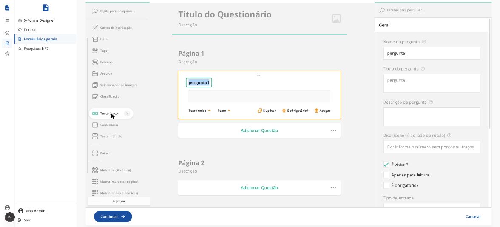
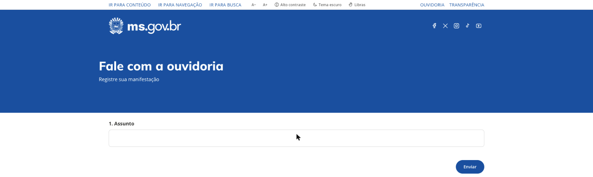
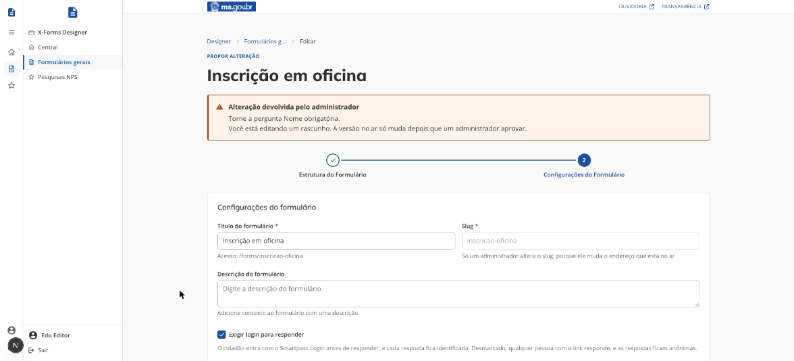
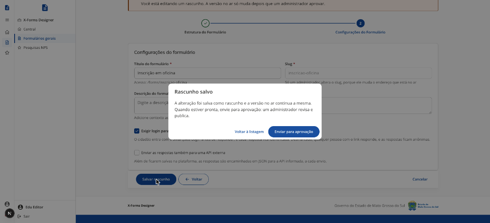

# Criar e editar formulários

[← Manual do X-Forms](README.md)

A criação e a edição têm duas etapas: **Estrutura do Formulário** e **Configurações do Formulário**. Os botões ficam numa barra fixa no pé da tela: **Continuar** (ou **Salvar**) e **Voltar** à esquerda, **Cancelar** à direita. Se faltar um campo obrigatório, uma janela explica o que falta e o cursor vai para o campo.

## 1. Estrutura do formulário

1. Na **caixa de ferramentas**, à esquerda, clique no tipo de pergunta (por exemplo "Texto único") ou arraste-o para a página.
2. Com a pergunta selecionada, preencha o painel à direita, no grupo **Geral**: nome da pergunta, título, descrição e, se quiser, a dica ([Tipos de pergunta](04-tipos-de-pergunta.md)).
3. Marque **É obrigatório?** nas perguntas que o cidadão precisa responder.
4. Use as abas do topo quando precisar:
   - **Testar questionário**: responde o formulário como teste, sem gravar nada.
   - **Lógica**: regras como mostrar uma pergunta só quando outra tiver certa resposta ([Lógica e expressões](10-logica-e-expressoes.md)).
   - **Editor de JSON**: a estrutura completa em texto, para quem precisa ajustar algo direto.
5. Clique em **Continuar**.

O **título e a descrição do questionário** (no topo da estrutura) são o que aparece na faixa azul da página do cidadão. Se o questionário não tiver título, descrição nem logo, a faixa não aparece e o formulário começa direto nas perguntas.

## 2. Configurações do formulário

| Campo                                           | O que é                                                                                                                                                                                                                      |
| ----------------------------------------------- | ---------------------------------------------------------------------------------------------------------------------------------------------------------------------------------------------------------------------------- |
| Título do formulário                            | Nome do formulário na lista do Designer e no envio para a API externa.                                                                                                                                                       |
| Slug                                            | Parte do endereço do formulário, por exemplo `pesquisa-atendimento` vira `/app/x-forms/forms/pesquisa-atendimento`. Use letras minúsculas, números e hífen. Só o administrador altera o slug de um formulário que já existe. |
| Descrição do formulário                         | Texto opcional de apresentação.                                                                                                                                                                                              |
| Exigir login para responder                     | Marcado, o cidadão precisa entrar com o Smartpass Login para responder, e cada resposta fica identificada. Desmarcado, qualquer pessoa com o link responde, e as respostas ficam anônimas.                                   |
| Enviar as respostas também para uma API externa | Envia cada resposta gravada para a **URL da API** informada, com um exemplo do JSON ao lado. Com **Enviar a identificação de quem respondeu**, o envio inclui o userId.                                                      |

A autoria e as alterações são gravadas automaticamente pela ferramenta, a partir do usuário que está logado.

## Salvar: o que muda por papel

|        | Administrador                                                                     | Editor                                                                                                                                        |
| ------ | --------------------------------------------------------------------------------- | --------------------------------------------------------------------------------------------------------------------------------------------- |
| Criar  | **Salvar formulário** cria o formulário já publicado; a janela mostra o endereço. | O formulário nasce **Fora do ar** e vazio para o cidadão; o que o editor montou fica no rascunho. A janela oferece **Enviar para aprovação**. |
| Editar | **Salvar alterações** muda a versão no ar na hora.                                | **Salvar rascunho** guarda a proposta e a versão no ar continua igual. O slug fica travado. A janela oferece **Enviar para aprovação**.       |

Quando o editor abre um formulário que já tem rascunho dele, o Designer carrega o rascunho, não a versão no ar. O que acontece depois do envio está em [Alterações com aprovação](05-aprovacao.md).
