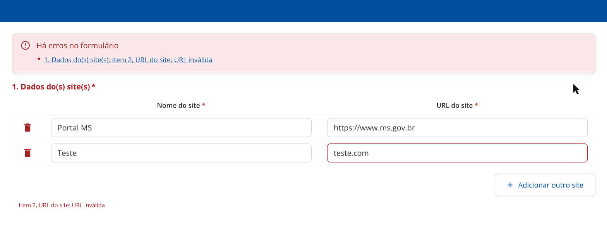
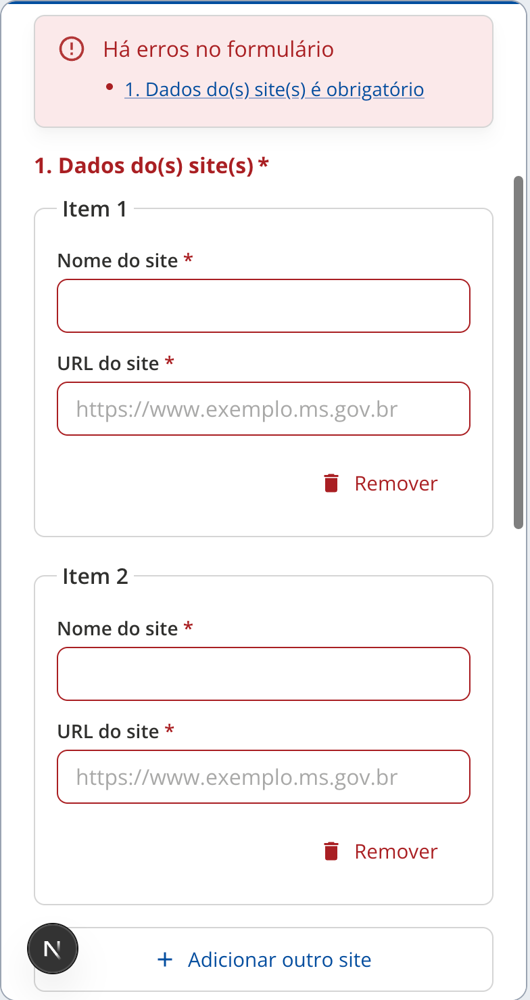

# Tipos de pergunta

[← Manual do X-Forms](README.md)

A caixa de ferramentas do Designer traz os tipos de pergunta do Survey Creator: texto, comentário, número, escolha única e múltipla, lista, tags, booleano, arquivo, seleção por imagem, classificação, avaliação, matrizes, assinatura, imagem, HTML e expressão. Este capítulo cobre os recursos específicos do X-Forms.

## Dica nas perguntas

O campo **Dica (ícone ⓘ ao lado do rótulo)** coloca um ícone ⓘ ao lado do título da pergunta. Ao passar o mouse ou focar o ícone pelo teclado, o cidadão vê o texto da dica; a tecla Esc fecha. Use a dica para orientações curtas, como "Informe o número sem pontos ou traços". O que o cidadão precisa ler sempre deve ir na **Descrição da pergunta**, que fica visível o tempo todo.

No Designer, o ⓘ também aparece no título da pergunta, na página e na aba Testar questionário. Se a dica for apagada, o ícone some.

## Lista de itens: Matriz (linhas dinâmicas)

Para pedir vários itens com os mesmos campos, como os sites de um órgão (nome e URL de cada um), use a pergunta **Matriz (linhas dinâmicas)**. Cada coluna é um campo do item e o cidadão adiciona ou remove itens pelo botão abaixo da lista.

- Em **Colunas**, crie uma coluna por campo e escolha o **Tipo de célula**. Na célula de texto, o **Tipo de entrada** (URL, e-mail, telefone ou número) define o teclado no celular e a checagem de formato no envio, e o **Texto de referência** mostra um exemplo dentro do campo (ex.: `https://www.exemplo.ms.gov.br`).
- Marque **É obrigatório?** na coluna que precisa ser preenchida em todos os itens.
- Para uma coluna de escolha (lista), cadastre as opções nas **Opções** da própria matriz: a página do cidadão usa essas opções em todas as colunas de escolha. Data dentro da matriz vira texto livre; se precisar, peça a idade ou use uma pergunta de data fora da matriz.
- Ajuste **Contagem de linhas**, **Contagem mínima de linhas** e **Contagem máxima de linhas** (com mínimo 1 a lista nunca fica vazia) e use o **Texto do botão para adicionar linhas** para algo como "Adicionar outro site".

No computador a lista aparece como tabela; no celular cada item vira um bloco ("Item 1", "Item 2") com os campos um embaixo do outro e o botão **Remover**. Um erro de formato aponta o item e a coluna, por exemplo "Item 2, URL do site: URL inválida", e a célula com problema fica destacada.

A URL precisa do protocolo: `teste.com` é recusado e `https://teste.com` é aceito. Por isso vale deixar o exemplo completo no **Texto de referência**.
