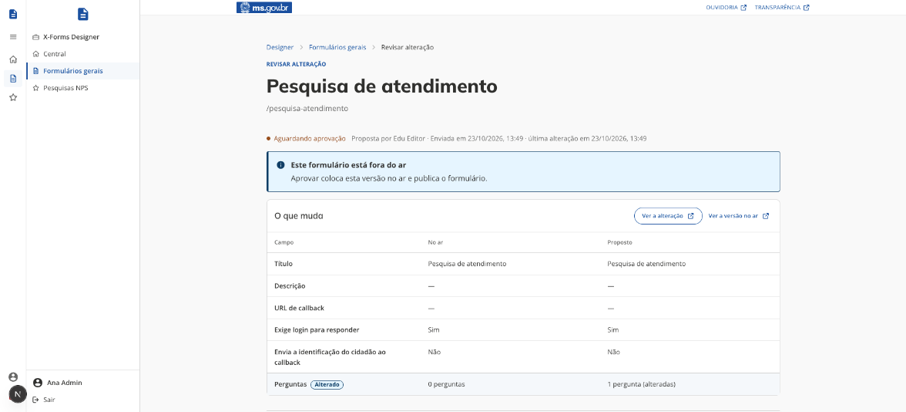
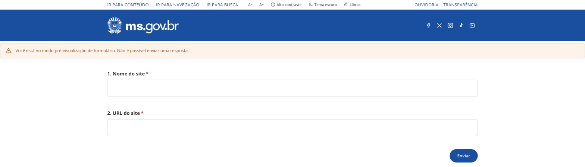
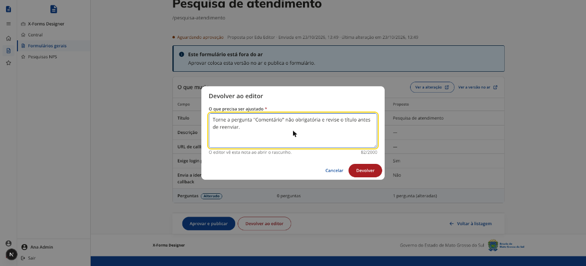
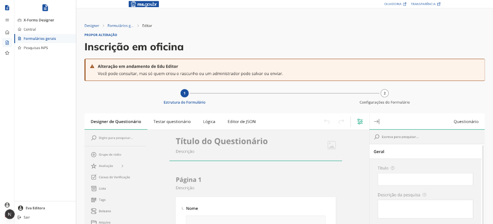

# Alterações com aprovação

[← Manual do X-Forms](README.md)

## O fluxo

1. O **editor** cria um formulário ou altera um existente e salva. O que ele salva vira um rascunho; a versão no ar não muda. Ver [Criar e editar](03-criar-e-editar.md).
2. O editor clica em **Enviar para aprovação**. Na lista, o formulário passa a mostrar _Aguardando aprovação_, e o administrador vê o aviso na [Central do Designer](01-acesso-e-central.md).
3. O **administrador** abre a revisão pelo aviso ou pela ação **Revisar alteração** da lista e escolhe **Aprovar e publicar** ou **Devolver ao editor**.
4. Aprovar coloca a alteração no ar e publica o formulário. Devolver exige uma nota, que o editor vê no topo do rascunho e na Central (_Alteração devolvida_). O editor ajusta, salva e envia de novo.

## A revisão

A revisão mostra o título do formulário, a situação e quem propôs. O quadro **O que muda** compara a versão no ar com a proposta, campo a campo: título, descrição, URL de callback, exigência de login, envio da identificação ao callback e perguntas. As linhas que mudaram ficam marcadas como _Alterado_. As decisões ficam numa barra fixa no pé da tela: **Aprovar e publicar**, **Devolver ao editor** e **Voltar à listagem**.

Alguns avisos pedem atenção antes de aprovar:

- **A URL de callback mudou**: as respostas dos cidadãos passarão a ir para outro endereço. Confirme que o destino é confiável.
- **O callback passará a receber a identificação do cidadão**: a identificação de quem responde passará a ir junto com as respostas.
- **Este formulário está fora do ar**: aprovar coloca a versão no ar e publica o formulário.

**Ver a alteração** abre o formulário como ficará depois da aprovação; **Ver a versão no ar** abre o que o cidadão vê hoje. As duas abrem em modo de prévia, sem gravar respostas.

**Devolver ao editor** pede o que precisa ser ajustado. Escreva a nota para quem vai corrigir, citando a pergunta ou o campo.

## Regras que o sistema aplica

- Cada formulário tem no máximo um rascunho, e ele é de quem o criou. Outro editor pode consultar, mas não salvar, enviar nem descartar; o Designer avisa ao abrir.
- Alterar um rascunho que aguarda aprovação o devolve para _Alteração em rascunho_: o editor precisa enviar de novo.
- O administrador só aprova o que revisou. Se o rascunho mudar depois que a revisão foi aberta, a aprovação é recusada e a revisão precisa ser aberta de novo.
- O slug e a coleção do CMS ficam fora do rascunho: só o administrador muda, direto no formulário.
- O administrador pode continuar editando a versão no ar direto. Isso não muda o rascunho pendente; a revisão mostra a diferença em relação ao que estiver no ar na hora.
- Um formulário criado por editor fica vazio para o cidadão até a aprovação: a página pública não mostra o conteúdo proposto e não aceita respostas.

