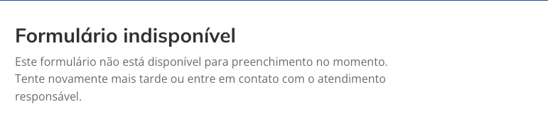

# Divulgar e acompanhar respostas

[← Manual do X-Forms](README.md)

## Os endereços públicos

- **Formulário geral**: `https://<endereço do portal>/app/x-forms/forms/<slug>?serviceSlug=<serviço>`. O `serviceSlug` identifica o serviço do portal ao qual a resposta pertence e é obrigatório.
- **Pesquisa NPS**: `https://<endereço do portal>/app/x-forms/nps/<slug>`. O `serviceSlug` é opcional e, quando informado, permite filtrar as respostas por serviço no download.

Qualquer slug secundário abre o mesmo formulário.

## Prévia

A ação **Visualizar** da lista abre o formulário com `?isPreview=true`: a página mostra o aviso de pré-visualização e não envia respostas. A prévia mostra também formulários fora do ar, por isso só funciona para quem tem um papel do Designer; para qualquer outra pessoa a página mostra "Formulário indisponível". A prévia da alteração proposta (`&version=draft`) segue a mesma regra.

## Respostas

O administrador baixa as respostas em CSV pela ação **Baixar respostas** da lista. Na pesquisa NPS dá para escolher todas as respostas ou as de um serviço. O editor não acessa as respostas, que podem conter dados pessoais dos cidadãos.

Com **Enviar as respostas também para uma API externa** ligado, cada resposta gravada também é enviada para a URL informada nas configurações ([Criar e editar](03-criar-e-editar.md)).
