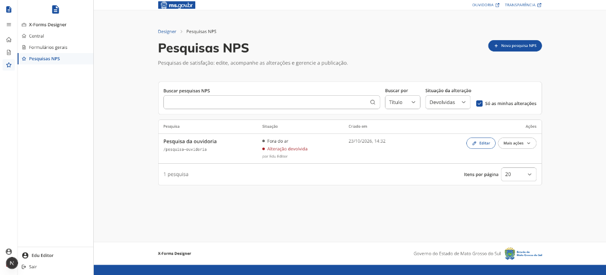
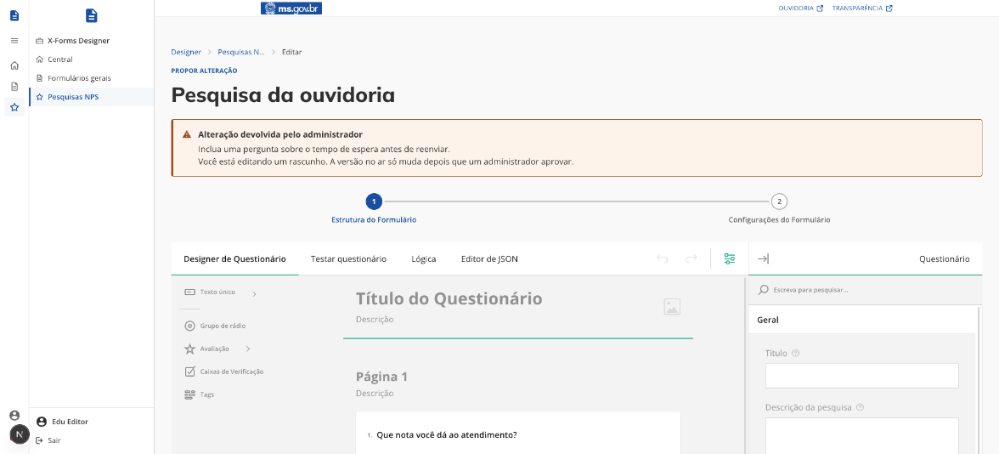
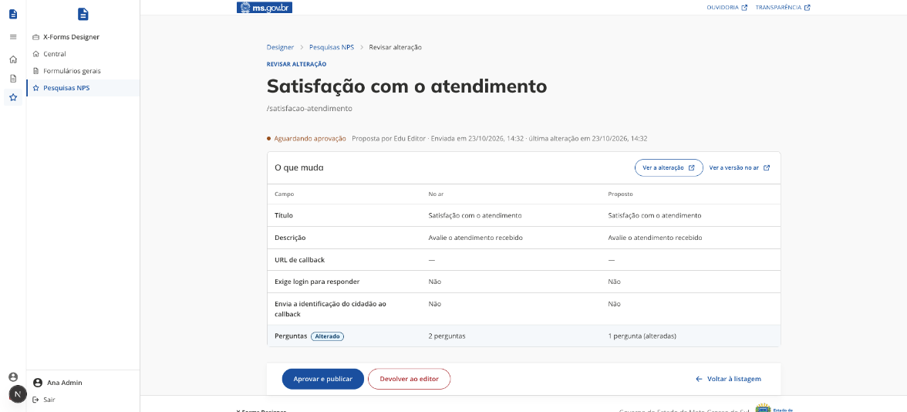

# Pesquisas NPS

[← Manual do X-Forms](README.md)

A pesquisa NPS mede a satisfação com um serviço. Ela é criada pelo atalho **NPS Designer** da [Central do Designer](01-acesso-e-central.md) ou pelo botão **Nova pesquisa NPS** e acompanhada em **Pesquisas NPS**, no menu lateral, e segue as mesmas regras dos formulários gerais: o administrador publica direto; o editor cria e altera em rascunho, que só vai ao ar com a aprovação de um administrador ([Alterações com aprovação](05-aprovacao.md)).

|                         | Formulário geral                             | Pesquisa NPS                                                      |
| ----------------------- | -------------------------------------------- | ----------------------------------------------------------------- |
| Para quê                | Coletar dados ligados a um serviço do portal | Medir a satisfação com um serviço                                 |
| Quem cria               | Administrador e editor                       | Administrador e editor                                            |
| Tipos de pergunta       | Todos os do Designer                         | Texto, avaliação, caixas de seleção, tags e grupo de rádio        |
| Login para responder    | Exigido por padrão                           | Não exigido por padrão                                            |
| Serviço no link         | Obrigatório (`serviceSlug`)                  | Opcional                                                          |
| Alteração com aprovação | Sim, quando quem altera é editor             | Sim, quando quem altera é editor                                  |
| Respostas               | Download em CSV pelo administrador           | Download em CSV pelo administrador, com todas ou as de um serviço |

A lista, a criação, a edição, os filtros e a revisão funcionam como no formulário geral ([Lista de formulários](02-lista-de-formularios.md), [Criar e editar](03-criar-e-editar.md) e [Alterações com aprovação](05-aprovacao.md)).

