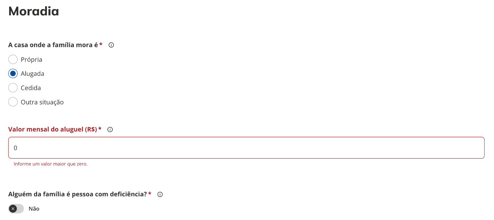
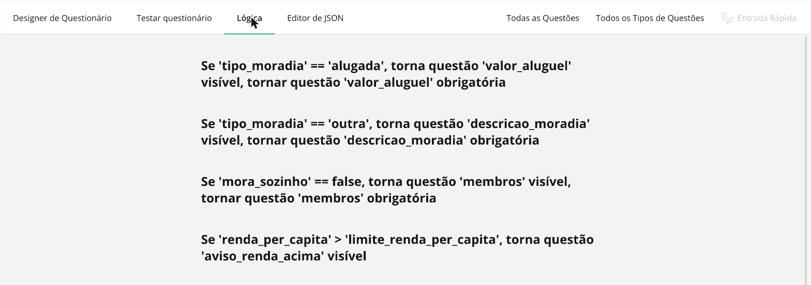
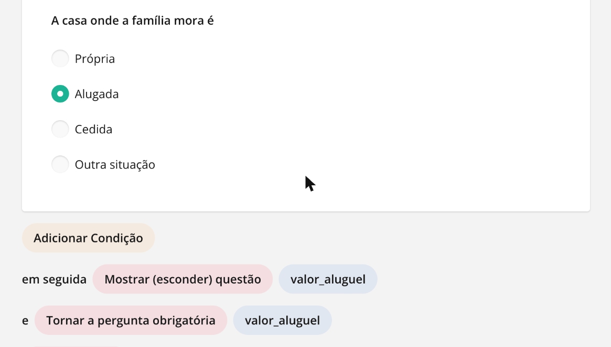
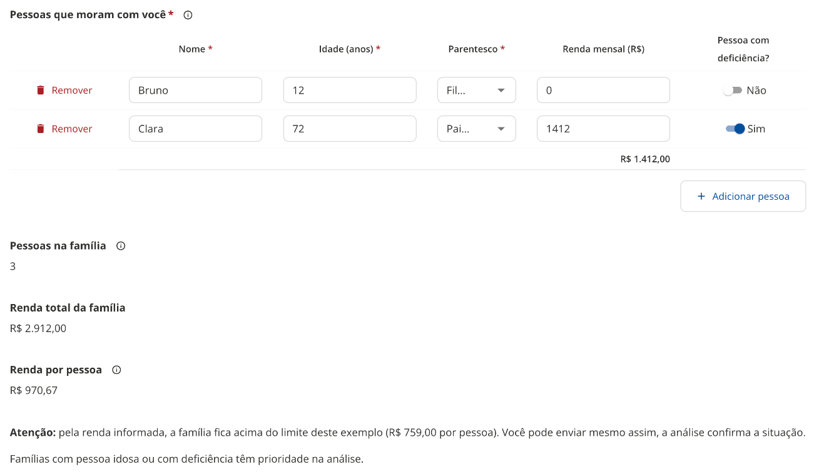

# Lógica e expressões

[← Manual do X-Forms](README.md)

Lógica é o que faz um formulário reagir ao que o cidadão responde: mostrar uma pergunta só quando outra tiver certa resposta, tornar um campo obrigatório em uma situação, calcular um valor, pular uma página ou encerrar o formulário mais cedo. Tudo isso é escrito como **condições** e **expressões**, e este capítulo explica como pensar nelas, como montá-las no Designer e o que a página do cidadão entende.

O Designer é o Survey Creator do **SurveyJS 1.12.14** e o formulário é salvo no JSON do SurveyJS, com a mesma gramática de condições e expressões usada pelo construtor do X-Forms do CMS. É isso que garante a compatibilidade quando um formulário criado aqui é importado no X-Forms do CMS: as regras continuam valendo, desde que fiquem dentro do que este capítulo descreve. A página que o cidadão responde não roda o SurveyJS: ela tem um renderizador próprio que interpreta as mesmas regras. Quando o renderizador e o SurveyJS se comportam diferente, a [seção 9](#9-o-que-o-portal-faz-diferente-do-surveyjs) diz o que fazer.

Os exemplos vêm de um formulário de demonstração, o pré-cadastro familiar para programas sociais: o cidadão informa a moradia e as pessoas da casa, e o formulário calcula a renda por pessoa e mostra avisos conforme as respostas.

## 1. Como pensar numa regra

Toda regra tem três partes: **onde** ela vale (uma pergunta, uma coluna de matriz, uma página ou o formulário inteiro), **o que** ela faz (mostrar, habilitar, exigir, limpar, definir, pular, encerrar) e **quando** ela vale (a condição). A condição é sempre uma pergunta sobre as respostas: "a moradia é alugada?", "a renda por pessoa passa do limite?", "a lista de interesses contém saúde?". Quando a resposta é sim, a regra age; quando é não, a regra não faz nada.

No formulário de demonstração, a pergunta _Valor mensal do aluguel_ só faz sentido quando o cidadão marcou _Alugada_ em _A casa onde a família mora é_. Então, na pergunta do aluguel, a regra **Torne a pergunta visível se** recebe a condição `{tipo_moradia} = 'alugada'`. Como nesse caso o valor precisa ser informado, a regra **Faça a pergunta obrigatória se** recebe a mesma condição, e um validador recusa zero.



A chave para ler qualquer condição: o que está entre chaves é o **nome da pergunta** (o campo **Nome** do painel de propriedades, que também é a chave da resposta no envio), e o que está entre aspas simples é um **valor**. Em perguntas de escolha, o valor é o valor da opção, não o texto que o cidadão lê (veja [Armadilhas](#10-armadilhas-comuns)).

## 2. Onde as regras ficam no Designer

Há três caminhos para a mesma regra, e o que se faz em um aparece nos outros:

- **Painel de propriedades → Lógica**, com a pergunta selecionada. Cada regra tem um campo de texto para a condição e o ícone de varinha mágica, que abre o construtor.
- **Aba Lógica**, no topo do Designer. Lista todas as regras do formulário em frases, como "Se 'tipo_moradia' == 'alugada', torna questão 'valor_aluguel' visível". Clicar numa regra abre o construtor com a condição e as ações; **Adicionar Condição** e **Adicionar Ação** completam a regra e **Terminar** fecha.
- **Editor de JSON**, para quem precisa ajustar direto. Cada regra é uma propriedade da pergunta, como `"visibleIf": "{tipo_moradia} = 'alugada'"`.





## 3. As regras de uma pergunta

Ficam em **Painel de propriedades → Lógica**, com a pergunta selecionada. A coluna JSON é o nome da propriedade no Editor de JSON.

| Regra no Designer                                          | JSON                                        | Quando a condição é verdadeira...                                                              | Exemplo                                      |
| ---------------------------------------------------------- | ------------------------------------------- | ---------------------------------------------------------------------------------------------- | -------------------------------------------- |
| Torne a pergunta visível se                                | `visibleIf`                                 | ...a pergunta aparece. Fora disso, fica oculta.                                                | `{tipo_moradia} = 'alugada'`                 |
| Editável se                                                | `enableIf`                                  | ...a pergunta pode ser respondida. Fora disso, aparece desabilitada.                           | `{aceite} = true`                            |
| Faça a pergunta obrigatória se                             | `requiredIf`                                | ...a pergunta passa a ser obrigatória.                                                         | `{tipo_moradia} = 'alugada'`                 |
| Redefinir valor se                                         | `resetValueIf`                              | ...a resposta é apagada. Útil quando a resposta anterior deixa de fazer sentido.               | `{tipo_pessoa} <> 'pj'`                      |
| Defina o valor se + Definir expressão de valor             | `setValueIf` + `setValueExpression`         | ...a resposta recebe o resultado da expressão.                                                 | `{quantidade} notempty` e `{quantidade} * 2` |
| Escolhas estão visiveis se / Escolhas são selecionáveis se | `choicesVisibleIf` / `choicesEnableIf`      | ...as opções da pergunta de escolha aparecem (ou ficam selecionáveis). Vale para a lista toda. | `{tem_dependente} = true`                    |
| Expressão valor mínimo / máximo, em perguntas de data      | `minValueExpression` / `maxValueExpression` | ...limita as datas aceitas.                                                                    | `today()`                                    |

O campo **Valor de expressão pré-definida** (`defaultValueExpression`) aparece no painel, mas a página do cidadão não o aplica. Para começar uma pergunta com um valor calculado, use **Defina o valor se** ou um gatilho (seção 7).

**Página e painel** também têm **Visível se**: com a condição falsa, a página inteira é pulada e o painel inteiro some, com as perguntas de dentro.

**Colunas da matriz** (linhas dinâmicas ou dropdown) aceitam **Tornar a coluna visível se**, **Editável se**, **Tornar a coluna obrigatória se**, **Redefinir valor se** e **Defina o valor se**. A condição da coluna olha as respostas do formulário, não a linha: no exemplo, a coluna _Pessoa com deficiência?_ só aparece quando `{possui_pcd} = true`, para todas as linhas.

**Respostas de perguntas ocultas.** Uma pergunta oculta não é validada nem conta como obrigatória. O que acontece com a resposta dela é decidido em _Propriedades do questionário → Data → Limpar valores invisíveis_: **ao completar** (padrão: a resposta oculta é descartada no envio), **ao ocultar**, **Quando a pergunta ou seu painel/página fica oculto** ou **Nunca**.

## 4. Operadores

O construtor monta a condição em três partes: a **pergunta**, o **operador** e o **valor**. **Adicionar Condição** acrescenta outra linha, e você escolhe se as linhas se juntam com _e_ (todas precisam valer) ou _ou_ (basta uma).

| Operador no construtor                                           | Na expressão         | Serve para                                                                 |
| ---------------------------------------------------------------- | -------------------- | -------------------------------------------------------------------------- |
| é igual a                                                        | `=`                  | texto, número, opção única, sim/não                                        |
| é diferente de                                                   | `<>`                 | o contrário de "é igual a"                                                 |
| é maior que, é maior ou igual a, é menor que, é menor ou igual a | `>`, `>=`, `<`, `<=` | números, datas                                                             |
| contém                                                           | `contains`           | múltipla escolha e tags (a lista contém o valor) e texto (contém o trecho) |
| não contém                                                       | `notcontains`        | o contrário de "contém"                                                    |
| é qualquer um de                                                 | `anyof`              | a resposta é uma das opções listadas                                       |
| contém todos                                                     | `allof`              | múltipla escolha com todas as opções listadas                              |
| está vazio                                                       | `empty`              | sem resposta                                                               |
| está preenchido                                                  | `notempty`           | com qualquer resposta                                                      |

Com "é qualquer um de" e "contém todos", a lista fica entre colchetes: `{interesses} anyof ['saude', 'educacao']`.

## 5. Modo avançado: a gramática

O campo de texto da regra aceita a expressão escrita à mão. Vale a pena quando a condição mistura _e_ com _ou_, usa uma função ou faz conta. Uma expressão que o construtor não sabe representar continua valendo, só não volta para o modo visual.

| Peça       | Escrita                                                                      | Observações                                                                                                       |
| ---------- | ---------------------------------------------------------------------------- | ----------------------------------------------------------------------------------------------------------------- |
| Pergunta   | `{nome_da_pergunta}`                                                         | Em texto múltiplo e matrizes: `{endereco.cidade}`, `{membros[0].nome}`. Quantidade de linhas: `{membros.length}`. |
| Texto      | `'assim'`                                                                    | Aspas simples.                                                                                                    |
| Número     | `10`, `2.5`                                                                  | Ponto como separador decimal.                                                                                     |
| Sim/Não    | `true`, `false`                                                              | Sem aspas.                                                                                                        |
| Lista      | `['a', 'b']`                                                                 | Usada com `anyof` e `allof`.                                                                                      |
| Comparação | `=`, `<>`, `>`, `>=`, `<`, `<=`, `contains`, `notcontains`, `anyof`, `allof` | `==` e `!=` também valem.                                                                                         |
| Vazio      | `{x} empty`, `{x} notempty`                                                  | Depois da pergunta, sem valor.                                                                                    |
| Junção     | `and`, `or`                                                                  | Use parênteses para agrupar: `({a} = 1 or {b} = 1) and {c} notempty`.                                             |
| Conta      | `+`, `-`, `*`, `/`                                                           | Com números ou perguntas numéricas, e parênteses: `({a} + {b}) / 2`. `+` entre textos junta os textos.            |
| Função     | `nome(argumentos)`                                                           | Lista na seção seguinte.                                                                                          |

Não existe `not` nem resto de divisão (`%`). Para negar, use o operador contrário: `<>` em vez de "não é igual", `notcontains`, `empty`.

## 6. Funções disponíveis

| Função                                                                                      | Resultado                                                        | Exemplo                                            |
| ------------------------------------------------------------------------------------------- | ---------------------------------------------------------------- | -------------------------------------------------- |
| `sum(a, b, ...)`                                                                            | Soma. Aceita listas.                                             | `sum({adultos}, {criancas})`                       |
| `min(...)`, `max(...)`, `avg(...)`                                                          | Menor, maior valor e média.                                      | `max({nota1}, {nota2})`                            |
| `count(lista)`                                                                              | Quantidade de itens marcados.                                    | `count({interesses}) >= 2`                         |
| `sumInArray(matriz, 'coluna')`                                                              | Soma de uma coluna da matriz.                                    | `sumInArray({membros}, 'renda_mensal')`            |
| `countInArray(matriz, 'coluna')`                                                            | Quantas linhas têm a coluna preenchida.                          | `countInArray({membros}, 'nome') + 1`              |
| `avgInArray`, `minInArray`, `maxInArray`                                                    | Média, menor e maior valor de uma coluna.                        | `maxInArray({membros}, 'idade')`                   |
| As funções `...InArray` com um terceiro argumento                                           | Só as linhas que atendem ao filtro, escrito entre aspas simples. | `countInArray({membros}, 'nome', '{idade} >= 60')` |
| `iif(condição, se_sim, se_não)`                                                             | Escolhe um valor conforme a condição.                            | `iif({renda} > 5000, 'alta', 'baixa')`             |
| `today()`, `currentDate()`                                                                  | A data de hoje.                                                  | `{data_viagem} > today()`                          |
| `getDate(data)`                                                                             | Converte texto em data.                                          | `getDate({nascimento})`                            |
| `currentYear()`, `getYear(data)`, `year(data)`, `month(data)`, `day(data)`, `weekday(data)` | Partes de uma data.                                              | `year({nascimento}) < 2008`                        |
| `age(data)`                                                                                 | Idade em anos a partir de uma data de nascimento.                | `age({nascimento}) >= 18`                          |
| `dateDiff(a, b, unidade)`, `diffDays(a, b)`                                                 | Diferença entre datas (unidade `days`, `months` ou `years`).     | `diffDays({inicio}, {fim}) <= 30`                  |
| `substring(texto, início, fim)`                                                             | Trecho de um texto.                                              | `substring({cep}, 0, 2) = '79'`                    |

Não há função de arredondamento (`round`): para mostrar um valor com casas decimais fixas, use a pergunta **Expressão** com estilo de exibição número ou moeda.

## 7. Gatilhos, valores calculados e a pergunta Expressão

Com nada selecionado, **Propriedades do questionário → Lógica** traz o que vale para o formulário inteiro.

**Condições (gatilhos)** executam uma ação quando a condição vira verdadeira:

| Gatilho no Designer    | JSON            | O que faz                                                         |
| ---------------------- | --------------- | ----------------------------------------------------------------- |
| Completar questionário | `complete`      | Termina o formulário e envia, sem passar pelas páginas restantes. |
| Pular para a pergunta  | `skip`          | Vai direto para a pergunta escolhida.                             |
| Definir resposta       | `setvalue`      | Grava um valor fixo em uma pergunta.                              |
| Copiar resposta        | `copyvalue`     | Copia a resposta de uma pergunta para outra.                      |
| Executar expressão     | `runexpression` | Grava numa pergunta o resultado de uma expressão.                 |

**Valores calculados** são variáveis que o cidadão não vê, usadas nas condições e em outras expressões. No exemplo, `qtd_idosos` tem a expressão `countInArray({membros}, 'nome', '{idade} >= 60')` e o aviso de prioridade usa `{qtd_idosos} > 0` em **Visível se**. Um valor calculado **não vai na resposta enviada**; se o valor precisa chegar às respostas ou à API externa, use a pergunta Expressão.

**A pergunta Expressão** (grupo Conteúdo da caixa de ferramentas) mostra o resultado em tempo real e envia o valor com a resposta. O **Estilo de exibição de valor** pode ser número, moeda (com a moeda, como `BRL`), porcentagem ou data. No exemplo, _Renda por pessoa_ usa `(sumInArray({membros}, 'renda_mensal') + {renda_responsavel}) / (countInArray({membros}, 'nome') + 1)` com estilo moeda.

Na matriz, a coluna também pode ter **Tipo total** (soma, contagem, média, mínimo ou máximo), mostrado abaixo da coluna. O total vai na resposta como `<nome da matriz>-total`, por exemplo `"membros-total": { "renda_mensal": 1412 }`.



## 8. Validadores

Ficam em **Painel de propriedades → Validação → Validadores**; a lista de tipos usa os nomes abaixo. A mensagem aparece embaixo do campo e, no envio, num resumo no topo da página.

| Validador             | JSON          | O que confere                                        | Exemplo                                                    |
| --------------------- | ------------- | ---------------------------------------------------- | ---------------------------------------------------------- |
| expressão             | `expression`  | A condição precisa ser verdadeira.                   | `{declaracao_veracidade} = true`, `{data} >= today()`      |
| numérico              | `numeric`     | Número dentro do mínimo e do máximo.                 | mínimo 1 no valor do aluguel                               |
| texto                 | `text`        | Quantidade de caracteres e, se marcado, sem dígitos. | mínimo 10 caracteres                                       |
| regex                 | `regex`       | O texto segue um padrão.                             | CPF com ou sem pontuação: `^\d{3}\.?\d{3}\.?\d{3}-?\d{2}$` |
| e-mail                | `email`       | Formato de e-mail.                                   | `nome@exemplo.com`                                         |
| contador de respostas | `answercount` | Quantidade de opções marcadas na múltipla escolha.   | mínimo 2                                                   |

Escreva o **Texto** do validador dizendo o que fazer, como "Informe um valor maior que zero", e não só o que está errado.

## 9. O que o portal faz diferente do SurveyJS

A aba **Testar questionário** roda o SurveyJS do Designer, não o renderizador do portal, então uma regra pode funcionar no teste e não na página do cidadão, ou o contrário. Confira sempre na **Visualizar** da lista ([prévia](06-divulgar-e-respostas.md#prévia)), que usa o mesmo renderizador do portal e não grava resposta.

| No SurveyJS (e no Testar questionário)                                                                         | Na página do cidadão                                        | O que fazer                                                                                                                       |
| -------------------------------------------------------------------------------------------------------------- | ----------------------------------------------------------- | --------------------------------------------------------------------------------------------------------------------------------- |
| Uma função com filtro funciona direto na condição: `countInArray({membros}, 'nome', '{idade} >= 60') > 0`      | A condição não reconhece o filtro e fica falsa.             | Calcule num valor calculado (`qtd_idosos`) e compare o resultado: `{qtd_idosos} > 0`.                                             |
| `%` dá o resto da divisão.                                                                                     | Não existe.                                                 | Evite. Para "número par", use uma pergunta de escolha ou valide no destino das respostas.                                         |
| **Escolhas estão visiveis se** vale opção por opção, com `{item}`.                                             | Vale para a lista toda; `{item}` não tem valor.             | Use para mostrar ou esconder todas as opções. Para esconder opções específicas, separe em perguntas com **Visível se**.           |
| A coluna de escolha da matriz pode ter opções próprias.                                                        | As colunas de escolha usam as **Opções** da própria matriz. | Cadastre as opções na matriz (painel da matriz → Opções), não na coluna.                                                          |
| Um texto só com dígitos, como o CEP `79800000`, é tratado como número: `substring({cep}, 0, 2)` devolve vazio. | O texto continua texto e `substring` devolve `'79'`.        | Teste no Visualizar; se o formulário também for usado no CMS, prefira comparar a pergunta inteira ou guardar o CEP com a máscara. |
| Célula de matriz com tipo de entrada data.                                                                     | A célula vira texto livre.                                  | Peça a idade (número) ou use uma pergunta de data fora da matriz.                                                                 |
| **Valor de expressão pré-definida** preenche a pergunta.                                                       | Não é aplicado.                                             | Use **Defina o valor se** ou um gatilho **Executar expressão**.                                                                   |
| **Questionário Completo** mostra a página de conclusão configurada.                                            | O portal mostra a janela "Resposta enviada!".               | Não dependa da página de conclusão para orientar o cidadão; coloque a orientação na última página.                                |

## 10. Armadilhas comuns

**Valor ≠ rótulo.** Em uma pergunta de escolha, a condição compara o **valor** da opção. Se a opção tem valor `alugada` e texto "Alugada", a condição é `{tipo_moradia} = 'alugada'`. Quando a opção foi criada só com o texto, valor e texto são iguais. Confira na aba Opções da pergunta.

**Múltipla escolha é uma lista.** Em _Caixas de verificação_ e _Tags_ a resposta é uma lista, então `=` quase nunca é o que você quer: use `contains` ("marcou saúde"), `anyof` ("marcou saúde ou educação") ou `allof` ("marcou as duas").

**Vazio não é zero.** Uma pergunta numérica sem resposta está `empty`, e zero é uma resposta (`notempty`). Para "informou um valor positivo", combine: `{valor} notempty and {valor} > 0`.

**Sim/Não começa em "Não".** A pergunta booleana aparece desligada, com valor `false`. Uma condição `{mora_sozinho} = false` já vale antes de o cidadão mexer, por isso no exemplo a lista de pessoas aparece de início.

**Renomear a pergunta quebra a condição.** As regras guardam o nome da pergunta. Se `tipo_moradia` virar `moradia`, toda condição com `{tipo_moradia}` deixa de funcionar até ser atualizada. A aba Lógica ajuda a achar as regras afetadas.

**Perguntas em outra página.** Uma condição pode citar qualquer pergunta do formulário, inclusive de páginas anteriores. Citar uma pergunta de uma página posterior funciona, mas a condição só vira verdadeira quando o cidadão chegar lá.

**Obrigatória e oculta.** Uma pergunta obrigatória que está oculta não bloqueia o envio. É o esperado: o **Visível se** já diz que ela não se aplica.

**Aspas.** Texto sempre entre aspas simples. `{uf} = MS` não funciona; `{uf} = 'MS'` sim.

## 11. Receitas prontas

| Quero...                                               | Onde                                               | Condição ou expressão                                                               |
| ------------------------------------------------------ | -------------------------------------------------- | ----------------------------------------------------------------------------------- |
| Pedir o valor do aluguel só para quem mora de aluguel  | Visível se e Obrigatória se do valor               | `{tipo_moradia} = 'alugada'`                                                        |
| Mostrar "Qual?" quando marcar "Outro"                  | Visível se e Obrigatória se da pergunta "Qual?"    | `{motivo} = 'outro'`                                                                |
| Perguntar o motivo da nota baixa num NPS               | Visível se do comentário                           | `{nota} <= 6`                                                                       |
| Pedir o nome do responsável para menores               | Visível se do responsável                          | `age({nascimento}) < 18`                                                            |
| Mostrar uma coluna da matriz só quando faz sentido     | Tornar a coluna visível se                         | `{possui_pcd} = true`                                                               |
| Contar quantas pessoas da lista atendem a um critério  | Valor calculado                                    | `countInArray({membros}, 'nome', '{idade} >= 60')`                                  |
| Mostrar um aviso quando esse número passa de zero      | Visível se de uma pergunta HTML                    | `{qtd_idosos} > 0`                                                                  |
| Mostrar o total em tempo real                          | Pergunta Expressão, estilo moeda                   | `sumInArray({membros}, 'renda_mensal') + {renda_responsavel}`                       |
| Comparar com um limite que pode mudar                  | Valor calculado com o limite e Visível se do aviso | `limite_renda_per_capita` = `759`; `{renda_per_capita} > {limite_renda_per_capita}` |
| Exigir que o cidadão confirme uma declaração           | Validador expressão na pergunta Sim/Não            | `{declaracao_veracidade} = true`                                                    |
| Não aceitar data no passado                            | Validador expressão na pergunta de data            | `{data_agendamento} >= today()`                                                     |
| Exigir ao menos duas opções marcadas                   | Validador contador de respostas                    | mínimo 2                                                                            |
| Encerrar o formulário para quem não atende ao critério | Gatilho Completar questionário                     | `{reside_no_estado} = false`                                                        |
| Pular a página de endereço para quem já é cadastrado   | Visível se da página                               | `{ja_cadastrado} = true` na página de confirmação, `false` na de endereço           |

Monte a regra, abra a **Visualizar** e percorra os dois caminhos (condição verdadeira e falsa) antes de salvar ou de enviar para aprovação.

## 12. Lógica e o envio para a API externa

Com **Enviar as respostas também para uma API externa** ligado ([Criar e editar](03-criar-e-editar.md#2-configurações-do-formulário)), o JSON enviado tem em `answers` tudo o que o cidadão respondeu, os valores das perguntas Expressão e os totais da matriz. Perguntas ocultas ficam de fora (com o padrão **ao completar**) e valores calculados não vão.

```json
{
  "formName": "Pré-cadastro familiar para programas sociais (demonstração)",
  "serviceSlug": "<serviço do portal>",
  "submittedAt": "2026-10-23T18:51:50.000Z",
  "answers": {
    "tipo_moradia": "alugada",
    "valor_aluguel": 700,
    "membros": [
      { "nome": "Bruno", "idade": "12", "parentesco": "filho", "renda_mensal": "0", "pcd": false },
      {
        "nome": "Clara",
        "idade": "72",
        "parentesco": "pai_mae",
        "renda_mensal": "1412",
        "pcd": true
      }
    ],
    "qtd_pessoas": 3,
    "renda_total": 2912,
    "renda_per_capita": 970.6666666666666,
    "membros-total": { "renda_mensal": 1412 }
  }
}
```

Note que as células de texto da matriz chegam como texto (`"12"`), e que o cálculo da página é uma ajuda ao cidadão: quem recebe as respostas deve refazer as contas que decidem alguma coisa, como a elegibilidade, em vez de confiar no valor enviado.
