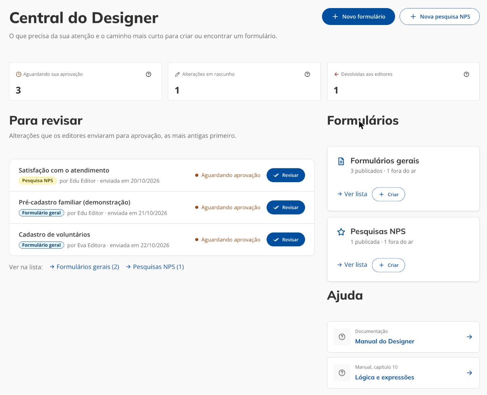

# Manual do usuário do X-Forms (Designer)

Este manual é para quem usa o **Designer** do X-Forms: o administrador, que faz tudo e aprova as alterações, e o editor, que monta e altera formulários em rascunho. Ele descreve as telas, o que cada botão faz e as regras que o sistema aplica por trás. A visão técnica (rotas, APIs, variáveis de ambiente, renderizador) está em [Formulários digitais](https://gitlabs.ms.gov.br/xvia/x-forms/xvia-x-forms/-/blob/develop/docs/forms.md) e as regras de acesso, em [Segurança & LGPD](https://gitlabs.ms.gov.br/xvia/x-forms/xvia-x-forms/-/blob/develop/docs/security.md).

As capturas vêm de um ambiente local com dados de teste. Quando uma tela muda, o manual e a captura mudam na mesma entrega; o capítulo [Manutenção deste manual](09-manutencao.md) explica como regenerar as imagens.

## Sumário

Este arquivo tem a visão geral: o que é o X-Forms, quem faz o quê e os conceitos que aparecem em todas as telas. Cada tópico abaixo é um arquivo próprio.

| Tópico                                                        | O que cobre                                                                                                                                          |
| ------------------------------------------------------------- | ---------------------------------------------------------------------------------------------------------------------------------------------------- |
| [Acesso e Central do Designer](01-acesso-e-central.md)        | Como entrar, a tela do Designer (menu lateral e trilha), a Central e os avisos de pendência.                                                         |
| [Lista de formulários](02-lista-de-formularios.md)            | Colunas, situação no ar e da alteração, busca, filtros e as ações de cada linha.                                                                     |
| [Criar e editar](03-criar-e-editar.md)                        | As duas etapas (estrutura e configurações), salvar, editar e o que muda para o editor.                                                               |
| [Tipos de pergunta](04-tipos-de-pergunta.md)                  | A dica nas perguntas e a lista de itens (matriz com linhas dinâmicas).                                                                               |
| [Lógica e expressões](10-logica-e-expressoes.md)              | Regras de visibilidade e obrigatoriedade, operadores, funções, gatilhos, valores calculados, validadores e o que o portal faz diferente do SurveyJS. |
| [Alterações com aprovação](05-aprovacao.md)                   | O fluxo editor → administrador, a revisão, aprovar, devolver e as regras do rascunho.                                                                |
| [Divulgar e acompanhar respostas](06-divulgar-e-respostas.md) | Os endereços públicos, o `serviceSlug`, a prévia e o download das respostas.                                                                         |
| [Pesquisas NPS](07-pesquisas-nps.md)                          | O que muda na pesquisa de satisfação.                                                                                                                |
| [Problemas comuns](08-problemas-comuns.md)                    | Cada mensagem e o que fazer.                                                                                                                         |
| [Manutenção deste manual](09-manutencao.md)                   | Como regenerar as capturas.                                                                                                                          |

## O que é o X-Forms

O X-Forms é a ferramenta do portal para criar formulários e pesquisas de satisfação (NPS) e coletar as respostas dos cidadãos. Ela tem duas partes:

- **Designer**: onde a equipe autorizada cria, edita, aprova, publica e acompanha os formulários. Fica em `/app/x-forms/designer`, no endereço do portal.
- **Formulário publicado**: a página que o cidadão abre para responder, em `/app/x-forms/forms/<slug>` (formulários gerais) ou `/app/x-forms/nps/<slug>` (pesquisas NPS). O cidadão nunca entra no Designer.

## Quem faz o quê: papéis

O acesso vem do grupo da pessoa no Smartpass Login. Quem é incluído num grupo precisa sair e entrar de novo para o acesso valer.

| Papel             | Grupo                            | O que pode                                                                                                                                                                    | O que não pode                                                                                                                               |
| ----------------- | -------------------------------- | ----------------------------------------------------------------------------------------------------------------------------------------------------------------------------- | -------------------------------------------------------------------------------------------------------------------------------------------- |
| **Administrador** | `/portal/xforms-designer/admin`  | Tudo: formulários gerais e NPS, publicar e desativar, excluir, slugs, baixar respostas, editar direto a versão no ar, revisar, aprovar e devolver as alterações dos editores. | Nada fica de fora no Designer.                                                                                                               |
| **Editor**        | `/portal/xforms-designer/editor` | Criar formulários gerais e pesquisas NPS e propor alterações num rascunho, enviar para aprovação, consultar as listas, visualizar e duplicar.                                 | Publicar, desativar, excluir, mexer em slugs, baixar respostas e aprovar. Nada do que ele faz vai ao ar sem a aprovação de um administrador. |

Quem entra sem nenhum dos dois grupos vê a tela **Acesso restrito**. O cidadão que só responde formulários não precisa de permissão nenhuma.

## Conceitos que aparecem em todas as telas

**Formulário geral e pesquisa NPS.** São os dois tipos. O formulário geral coleta dados ligados a um serviço do portal; a pesquisa NPS mede a satisfação com um serviço. Ver [Pesquisas NPS](07-pesquisas-nps.md).

**Situação no ar e situação da alteração são duas coisas.** A situação no ar diz o que o cidadão vê: _Publicado_ ou _Fora do ar_. A situação da alteração diz em que pé está a proposta de um editor: _Alteração em rascunho_, _Aguardando aprovação_ ou _Alteração devolvida_. Um formulário publicado pode ter, ao mesmo tempo, uma alteração aguardando aprovação: o cidadão continua respondendo a versão no ar enquanto a próxima é revisada.

**Rascunho.** Cada formulário tem no máximo uma alteração em andamento, e ela pertence a quem a criou. Quando um administrador aprova, o rascunho vira a versão no ar e deixa de existir.

**Slug.** É o endereço do formulário no portal (`.../forms/meu-formulario`). O formulário pode ter slugs secundários, que abrem o mesmo formulário. Slugs são únicos entre todos os formulários.

**serviceSlug.** É o identificador do serviço do portal ao qual a resposta pertence. No formulário geral ele é obrigatório no link divulgado. Ver [Divulgar e acompanhar respostas](06-divulgar-e-respostas.md).
